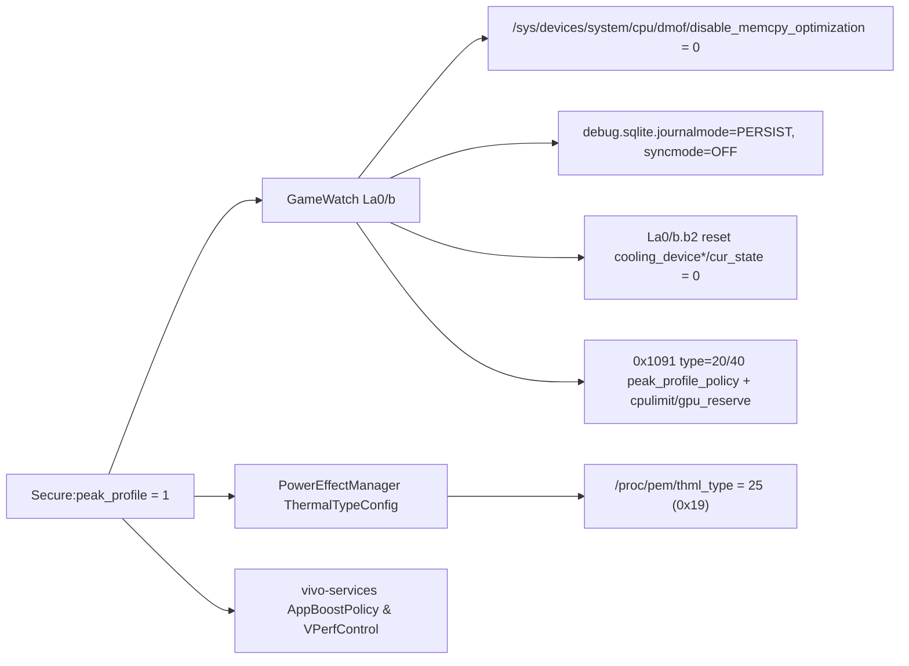

# iQOO 13 (`I2401` / `SM8750`) Exhaustive Performance, Thermal & Power Settings Audit

> [!NOTE]
> **Baseline Safety & Restoration Verified**: No permanent setting changes were left on the device. All temporary tests were verified against pre-test snapshots via automated pre/post-test snapshot diffing with **0 test-induced/unintended diffs** and `mWakefulness=Asleep`.

## Table of Contents

1. [Device Profile, Architecture & `uid=2000` Audit Scope](#1-device-profile-architecture--uid2000-audit-scope)
2. [Master Quick-Reference Index](#2-master-quick-reference-index)
3. [Power & Performance Modes (Vivo + AOSP)](#3-power--performance-modes-vivo--aosp)
4. [Benchmark Mode & Peak Profile Architecture](#4-benchmark-mode--peak-profile-architecture)
5. [Thermal Management, Thresholds, `ThermalTypeConfig` Modes & Vendor Power Configs](#5-thermal-management-thresholds-thermaltypeconfig-modes--vendor-power-configs)
6. [Gaming, Frame Rate Boost, AutoVRS/DDC & Q2 Display IC](#6-gaming-frame-rate-boost-autovrsddc--q2-display-ic)
7. [Display Refresh Rate & LTPO Controls](#7-display-refresh-rate--ltpo-controls)
8. [Charging, Bypass Charging & Battery Health Thermal Controls](#8-charging-bypass-charging--battery-health-thermal-controls)
9. [Standby, Sleep Optimization, Adaptive Battery, Memory/ZRAM & `device_config`](#9-standby-sleep-optimization-adaptive-battery-memoryzram--device_config)
10. [Settings UI Navigation -> Backing Key Map](#10-settings-ui-navigation---backing-key-map)
11. [Empirical Live Impact Test Results](#11-empirical-live-impact-test-results)
12. [Baseline Restoration Verification Summary](#12-baseline-restoration-verification-summary)

---

## 1. Device Profile, Architecture & `uid=2000` Audit Scope

| Property | Observed Value |
| :--- | :--- |
| **ADB Serial** | *(redacted)* |
| **Model / Brand / Board** | `I2401` / `PD2408F_EX` / `PD2408GF_EX` (`iQOO 13`, Global ROM: `ro.vivo.product.overseas=yes`) |
| **SoC / Solution** | Qualcomm `SM8750` (`QCOM`, big/little Oryon `policy0` cpus `0–5` @ `384–3532.8 MHz`, prime `policy6` cpus `6–7` @ `1017.6–4320.0 MHz`) |
| **OS / Build** | `OriginOS 7` (`Android 17` / `SDK 37`), `PD2408GF_EX_A_17.2.10.5.W20` |
| **Memory** | `12 GB` (`sys.vivo.project.ramsize=12`), ZRAM writeback capable |
| **Display Panel** | `1440 x 3168` (`1080 x 2376` scaled mode supported), LTPO (`28.8–144.0 Hz`), Q2/VisDisplay IC (`vendor.novatek.hardware.visdisplaysrv-service`) |
| **Privilege Context** | Non-rooted ADB shell `uid=2000`, SELinux Enforcing |

### Active Performance, Thermal & Power Subsystems
Observed running in `dumpsys cpuinfo` and static package analysis:
- **Qualcomm Perf & Thermal HALs**: `vendor.qti.hardware.perf2-hal-service`, `vivo-vperf-hal-1-0`, `poweropt-service` (`liboffscreenpoweroptfeature.so`, `libpsmoptfeature.so`, etc.), `thermal-engine-v2`, `ThermalHAL AIDL 3`.
- **Vivo Power & Thermal Engines**: `com.vivo.pem` / `com.pemPieProcess` (PowerEffectManager), `com.iqoo.powersaving` (`PowerModeChangeService`), `com.bbk.SuperPowerSave` (Super Battery Saver), `com.vivo.fuelsummary` (`BatteryDirectorService` / `SmartChargeLimitService`), `com.vivo.sps:rms` (SuperProcessSystem / RMS / ZRAM WB).
- **Game & Display Pipelines**: `com.vivo.gamewatch` (`La0/b;`, `Ld0/y;`), `com.vivo.gamecube` (Game Sidebar / Modes / Bypass UI), `VivoRefreshRatePolicyService` (`vivo_rrm`), `GameManagerService` (`vivo-services.jar`), `vendor.novatek.hardware.visdisplaysrv-service` (Q2 MEMC / VSR / SDR2HDR).

### Access & Controllability Boundaries (`uid=2000`)
- **Writable via ADB (`uid=2000`)**: `settings put/delete` in `system`, `secure`, and `global` namespaces; `cmd power`; `cmd thermalservice`; `cmd game` (only for packages declaring `android:appCategory="game"`); `cmd battery`; `setprop debug.*` (ephemeral debug properties).
- **Readable Telemetry**: `/sys/devices/system/cpu/cpufreq/policy{0,6}/*` (including `walt/*`), `/sys/devices/system/cpu/cpu{0,6}/core_ctl/*`, `/sys/class/thermal/cooling_device*` (63 devices), `/sys/class/thermal/thermal_zone*`, `/sys/devices/system/cpu/dmof/disable_memcpy_optimization`, `dumpsys {power,thermalservice,battery,display,game,vivo_rrm,vivo_display_enhance,deviceidle}`.
- **Restricted / Blocked at `uid=2000`**: `setprop persist.vivo.*` (SELinux denied); `am start-service` on `PowerModeChangeService`/`OriginPowerModeChangeService` (`Requires permission com.iqoo.powersaving.permission.MODE_CHANGE`); `/proc/pem/thml_type`, `/sys/rsc/svp`, `/sys/class/kgsl/kgsl-3d0/*`, `/sys/class/power_supply/*` (`Permission denied`).

---

## 2. Master Quick-Reference Index

| Identifier / Command | Domain | Baseline | Key Impact Area | Mutated Live? |
| :--- | :--- | :--- | :--- | :--- |
| `power_save_type` | System + Secure | `5` (Monster) | Power mode, thermal curve, CPU/GPU cooling caps | Yes (`1`, `2`, `6`, back to `5`) |
| `peak_profile` | Secure | `0` | **Benchmark Mode** (`thml_type=25`, clears cooling caps & `dmof`) | Yes (`1`, back to `0`) |
| `game_plus_mode_key` | System | `1` | Composite Monster+ (`7`) / BOOST+ (`8`) flag — OS thermal/FPS/`GameManagerService` hooks gated off (`ro.vivo.support_monster_plus` unset); only minor `GameCube` Q2 SR/XPQ helpers read it | Yes (`0`, back to `1`) |
| `power_save_type_performance` | System | *unset* (`null`) | Hidden Extreme Performance Mode — dead/inert on Global SM8750 (UI blocked; `GameWatch` gated by unset `persist.sys.supermode.enable`; `vperfmaps.xml` `qcom hintid=-1`) | Yes (`1`, deleted) |
| `sup_power_save_type` / `sys_super_power_save_mode` | Secure | `0` / `0` | Super Battery Saver (`com.bbk.SuperPowerSave`) | **No (blocked for safety)** |
| `vivo_gamethermal_switch` | System | `1` | Game Watch thermal throttling enable/disable switch | Yes (`0`, back to `1`) |
| `electroic_mode_enabled` | System | `0` | Esports Mode (`ModeType`/GameCube performance preset) | Yes (`1`, back to `0`) |
| `ai_turbo_enabled` | System | `0` | Multi-Turbo / AI Acceleration Engine + SuperProcessSystem | Yes (`1`, back to `0`) |
| `game_scene_more_fps` | System | `0` | Game high-FPS scene boost | Yes (`1`, back to `0`) |
| `gamewatch_vcs_mode` | Secure | `0` | GameWatch VCS thermal/fps mode | Yes (`1`, back to `0`) |
| `settings_battery_charge_director` | Secure | `0` | Bypass Charging master switch (`persist.vivo.game_bypass_charge_flag`) | Yes (`1`, back to `0`) |
| `settings_battery_charge_director_game_cube` | Secure | `0` | Bypass Charging in-game trigger state | Yes (`1`, back to `0`) |
| `gamecube_force_bypass_mode` | Secure | *unset* | Force bypass charging override in GameCube | Yes (`1`, deleted) |
| `smart_charge_upper_value` | Secure | *unset* (`100`) | Charge stop percentage limit (`%`) | Yes (`80`, deleted) |
| `balance_charge_switch` / `optimize_charge_switch` | System | *unset* | Fast/balanced charge & optimized charge protection | Yes (`0`, deleted) |
| `vivo_screen_refresh_rate_mode` | Global | `1` (Smart) | Display refresh policy (`1`, `60`, `90`, `120`, `144`) | Yes (`60/90/120/144`, back to `1`) |
| `vivo_ltpo_setting` | System | `1` | LTPO variable refresh switching (`1`/`0`) | Yes (`0`, back to `1`) |
| `min_refresh_rate` / `peak_refresh_rate` | System | *unset* / `144.0` | AOSP `DisplayModeDirector` min/max refresh votes | Yes (`120`/`60`, restored) |
| `memc_main` / `super_resolution_main` | Global | `0` / `0` | Q2 IC Frame Interpolation (MEMC) & Super Resolution | Yes (`1`, back to `0`) |
| `pem_in_ccc_mode` / `adaptive_power_enable` | Secure | `1` / `1` | PEM background thermal/power control & Adaptive Battery | Yes (`0`, back to `1`) |
| `power_sleep_mode_enabled` / `power_sleep_mode_type` | System | `0` / `0` | Sleep standby restriction & mode (`0=all-day`, `1=night`) | Yes (`enabled=1`, back to `0`) |
| `persist.vendor.vivo.zramwb.enable` | Sysprop | *unset* | Extended RAM (ZRAM writeback) — triggers immediate reboot on UI toggle | **No (triggers reboot)** |
| `cmd power set-mode` / `set-fixed-performance-mode-enabled` | Shell `cmd` | `0` / `false` | AOSP Battery Saver / PowerHAL fixed performance hint | Yes (reverted) |
| `cmd thermalservice override-status` / `headroom` | Shell `cmd` | `false` (`0`) | AOSP Thermal status override / headroom query | Yes (`1`, `reset`) |
| `cmd game` | Shell `cmd` | *per-app* | AOSP `GameManagerService` per-game mode/scaling/fps | Queried / `reset` |

---

## 3. Power & Performance Modes (Vivo + AOSP)

### 3.1 `power_save_type` Enumeration & Cross-Service Mapping
Decoded from `GameCube` (`ModeType`, `ModeShiftHelper` `o.w`/`o.l`), `IqooPowerSaving` (`Lf5/j0;.q`, `BasePowerModeChangeService`), `vivo-framework` (`VPerfControl`), `PowerEffectManager` (`ThermalTypeConfig`, `BatteryState`), and `GameWatch` (`Ld0/y;.r/.t`):

> [!NOTE]
> **Two Distinct Numbering Schemes**: Android `Settings` (`System` / `Secure:power_save_type`) **only ever stores `1`, `2`, `5`, or `6`** — it is never written with `7` or `8`. Values **`7` (`MONSTER_PLUS`)** and **`8` (`BOOST_PLUS`)** exist solely inside `GameCube.apk`'s `ModeType` enum (`key_mode_in_game_<pkg>`) as **composite modes** pairing base `power_save_type` (`5` or `6`) with `System:game_plus_mode_key = 1`:
> - **Writing (`ModeShiftHelper` `o.w` / `shiftMode`)**: Selecting a mode sends `intent.action.POWER_MODE_CHANGE_SERVICE` (`source=23`) to `com.iqoo.powersaving` with base command `1004` (`1`), `1005` (`2`), `1011` (`5`), or `1014` (`6`). Selecting `MONSTER_PLUS` (`7`) or `BOOST_PLUS` (`8`) sends `1011` (`5`, if `a.q().d0()`) or `1014` (`6`), checks `backClipConnectState` (`a.b().a()`, external clip-on cooler attached), and writes `System:game_plus_mode_key = 1` via `o.v(1)` when connected (exiting resets it to `0`).
> - **Reading (`ModeShiftHelper` `o.l`)**: Checks `System:game_plus_mode_key == 1` first (`MONSTER_PLUS` / `BOOST_PLUS` via `a.b().e()`); otherwise falls back to `Secure:power_save_type` (`1`, `2`, `5`, or `6`).

| `GameCube` `ModeType` | `Settings: power_save_type` | `System: game_plus_mode_key` | Device Effect & Downstream Observers |
| :---: | :---: | :---: | :--- |
| **`1` (`NORMAL` — Balanced)** | `1` | `0` | Default thermal & CPU curves (`vperfmaps.xml` standard hints, `ThermalTypeConfig` `o=1` -> `thermal_array[0]`, `com.vivo.vivoconsole.icon.status=0`, `GameWatch` `y.j=0` or `2` when charging <=90%). |
| **`2` (`POWER_SAVING` — Battery Saver)** | `2` | `0` | Triggers `BatteryState.in_power_save=true`, `AppBoostPolicy.isPowerSaveMode()=true`, Low-power vperf hints (`3112–3263 -> 0x1501–0x1506`), drops `vivo_screen_refresh_rate_mode->60` and `screen_off_timeout->30000` (via `Lz3/c` handler), sets `com.vivo.vivoconsole.icon.status=1`. |
| **`5` (`MONSTER` — Baseline)** | `5` | `0` | Recognized by `VPerfControl.isPerfStatus()` (`5 \|\| 6`), `ThermalTypeConfig` (`o == 5` selects `thermal_array[1]`, default `4`), `VivoInputPolicy`, `GameWatch` (`Ld0/y;.r` -> `y.j=1` or `3` when charging <=90%). Sets `com.vivo.vivoconsole.icon.status=2`, `Secure:system_property_power_mode_type=5`. |
| **`6` (`ENHANCED` — BOOST mode)** | `6` | `0` | Maps to UI **`BOOST mode`** (`battery_boost_mode`, cmd `1014`). Recognized alongside `5` by `VPerfControl.isPerfStatus()` and `GameWatch` (`Ld0/y;.r`). **Confirmed active live**: relaxed `cooling_device31/32` from `7/9` to `5/8` and raised awake CPU ceilings (`2.400 / 2.650 GHz` vs baseline Monster `1.997 / 2.438 GHz` at ~36°C skin). |
| **`7` (`MONSTER_PLUS`)** | **`5`** *(cmd `1011`)* | **`1`** *(if cooler attached)* | **OS-level tier gated off on this Global ROM** (see below). Designed to pair `5` + `game_plus_mode_key=1` to select `thermal_array[2]` (`app_monster_plus_policy`), VSR/MEMC/XPQ (`GameManagerService.updateMonsterPlusMode`), and `GameWatch` `y.j=5`. |
| **`8` (`BOOST_PLUS`)** | **`6`** *(cmd `1014`)* | **`1`** *(if cooler attached)* | **OS-level tier gated off on this Global ROM** (same `ro.vivo.support_monster_plus` gate as `7`). Pairs `6` + `game_plus_mode_key=1`. |

#### Why `MONSTER_PLUS` (`7`) & `BOOST_PLUS` (`8`) Cannot Trigger on This Global ROM
All three downstream system-level consumers check the read-only build property **`ro.vivo.support_monster_plus`**, which is **unset (`false`)** in `getprop`:
1. **`PowerEffectManager` (`ThermalTypeConfig.d()`)**: Requires `ro.vivo.support_monster_plus && this.i`, so `thermal_array[2]` (`com.vivo.pem.app_monster_plus_policy` / `thml_type=5`) never engages.
2. **`GameManagerService` (`SUPPORT_MONSTER_PLUS_MODE`)**: Evaluates `false` at init, so it skips `updateMonsterPlusMode()` and never registers an observer on `game_plus_mode_key`.
3. **`GameWatch` (`Ld0/y;.t()`)**: Requires `y.r && y.s` (`ro.vivo.support_monster_plus`), skipping the `"5"` Monster+ branch inside `Ld0/y;.r()`.
- *Only remaining side effect*: Two minor `GameCube` display-assist helpers (`GameSuperResolutionController` `m` and `LightTrackUtils` `q0.g`) still read `System:game_plus_mode_key` directly for per-game Q2 Super Resolution / XPQ checks — **not** CPU/GPU clocks or thermal limits.
- **Actually effective ladder on unrooted iQOO 13 (`PD2408F_EX`)**: `power_save_type=2` (Battery Saver) -> `1` (Balanced) -> `5` (Monster) -> `6` (BOOST) -> **`Secure:peak_profile=1`** (Benchmark Mode, full unthrottled clocks).

#### Companion Keys Mutated by Mode Transitions
- Setting `power_save_type=2` (Battery Saver) directly or via `IqooPowerSaving` can mutate companion keys across namespaces (`observed live` + `Lz3/c` bytecode):
  - `Secure:system_property_power_mode_type`, `System:power_sleep_mode_enabled`, `System:enforce_exit_vico`, `System:enhanced_dynamic_effects`, `System:global_animation_color_fade_style`, `System:global_animation_le_screenoff_switch`, `System:global_animation_le_screenon_switch`, `System:lockscreen_sounds_enabled`, `System:unlock_enter_launcher_animation`.
  - Managed via `IqooPowerSaving` UI/handler (`Lz3/c`, `Lf5/j0;.q`, `Lf5/z;.h/.i`): `Secure:power_save_enable`, `Global:low_power`, `Global:low_power_sticky`, `Global:low_power_sticky_auto_disable_level` (baseline `60`), `Global:low_power_mode_opened` (`1`), `Secure:low_power_manual_activation_count` (`3`), `Global:vivo_screen_refresh_rate_mode`, `Global/System:super_power_save_rate_mode`, `System:screen_off_timeout`, `Secure:save_mode_setting_screen_rate`, `Secure:power_save_change_screen_rate`, `Secure:save_mode_setting_screen_time`, `Secure:power_save_change_screen_time`, `System:power_lock_time_in_default`, `Secure:sys_last_mode_type` (`1`), `System:com.vivo.vivoconsole.icon.status` (`2`), `System:light_effect_power_saving_strategy_switch` (`0`), `Global:automatic_power_save_mode`, `Global:low_power_trigger_level`.
- **`PowerModeChangeService` (`OriginPowerModeChangeService`) Commands** (requires `com.iqoo.powersaving.permission.MODE_CHANGE`, blocked from `uid=2000`): `1000–1005`, `1006`, `1007`, `1009`, `1010–1015`, `1021`, `1022`, `1030`, `1031`, `1040`, `1041`, `1090–1092`. `GameCube` dispatches `1004`, `1005`, `1011`, `1014` (`source=23`).

### 3.2 Hidden Extreme Performance Mode (`power_save_type_performance` — Dead / Inert on Global SM8750)
- **Controller & UI Gating**: `com.vivo.settings.development.v` (`ExtremePerformanceModePreferenceController`), key `extreme_performance_mode`, writes `System:power_save_type_performance` (`0` or `1`). Its `isAvailable()` returns `false` because `VivoRomUtils.isOverSeas()` is `true` (`ro.vivo.product.overseas=yes`) AND `com.vivo.settings.utils.e0.v()` requires `persist.vivo.feature.super_performance_support == 1` (currently empty/unset).
- **Why forcing `power_save_type_performance=1` via ADB cannot trigger it either**:
  - `GameWatch` `Ld0/y;.z/.r` (`UserFpsSetting`) reads `System:power_save_type_performance` (`>0`) into flag `y.q`, **but** `Ld0/y;.u()` requires **both** `y.q == true` **and** `persist.sys.supermode.enable == "1"`. Because `persist.sys.supermode.enable` is unset on this ROM (default `"0"`), `y.u()` always returns `false` and clears `y.q` back to `false`.
  - Across all 16 audited system APKs/JARs, **no** power or thermal daemon (`PowerEffectManager`, `IqooPowerSaving`, `GameCube`, `SuperProcessSystem`, `vivo-framework`, `vivo-services`) reads `power_save_type_performance` (only `SuperPowerSave` `k2.f.c` touches it, solely to save/reset it during Super Battery Saver).
  - In `vperfmaps.xml`, `superperformance mode` (`commonid="0x00001091" type="11"`) defines an active hint only for MediaTek (`target="mtk" hintid="2002"`) and is a no-op (`hintid="-1"`) on Qualcomm (`target="qcom"`).
  - **Confirmed live (Test 3)**: Setting `System:power_save_type_performance=1` via ADB produced **zero effect** on `cooling_device31/32/35` (`7/9/4`) or `dmof` (`1`).

### 3.3 Super Battery Saver (Documented Only — Do Not Trigger)
- **Package / Service**: `com.bbk.SuperPowerSave`, started explicitly via `Lf5/n0;.a` (`intent.action.SUPER_POWER_SAVE_SERVICE`, extra `service_action=innerStart`).
- **State Keys / Props**: `Secure:sup_power_save_type` (`0`), `Secure:sys_super_power_save_mode` (`0`), `sys.super_power_save` (*empty*), `Global:power_save_memc_main`, plus `super_power_save_*` backup keys (`rate_mode`, `lock_time`, `wifi`, `bt`, `gps_int`, `nw`, `nt`, `nt2`, `touch_feedback`, `ap`, `night_mode`, `frozen`). Disables `Global:memc_main`, `Global:super_resolution_main`, sets `Global:vivo_screen_refresh_rate_mode` to `60`, and kills non-essential background/UI functions (`Secure:sps_default_white_apps`).

### 3.4 Hardware Monster Key & AI Button Mapping
- `System:monster_key_start` (observed in `VivoInputPolicy.updateMonsterModeSettings`), `System:jovi_key_function=game_space`, `Global:vtouch_custom_ai_key=0`, `Secure:super_power_change_for_last_key=0`. Holding AI Key + GamePad shoulder button triggers `VivoInputPolicy.triggerMonsterMode` if enabled.

### 3.5 AOSP `cmd power` & Doze (`deviceidle`)
- `cmd power set-mode [1|0]` (AOSP Battery Saver — note only engages cleanly when unplugged or `cmd battery unplug`), `cmd power set-fixed-performance-mode-enabled [true|false]` (PowerHAL sustained/fixed performance hint), `cmd power set-adaptive-power-saver-enabled [true|false]`.
- `dumpsys deviceidle` active Doze thresholds: `light_after_inactive_to=4m`, `light_idle_to=5m` (max `30m`), `inactive_to=15s`, `idle_to=1h` (max `6h`), `use_mode_manager=false`, `Global:cached_apps_freezer=device_default`.

---

## 4. Benchmark Mode & Peak Profile Architecture

**`Secure:peak_profile`** (`0` at baseline -> `1` when active) is the **true unthrottled Benchmark / Peak Performance switch** operational on this SM8750 Global ROM. When set to `1`:

1. **`GameWatch` (`La0/b;.a1`, `W1`, `X1`, `Z1`, `b2`)**:
   - Checks `persist.sys.peakprofileboost.enable` (defaults `"1"` when unset) and `persist.vivo.peak_profile_thermal.enable` (`1` at baseline; freeform `persist.vivo.freeform_peak_profile_thermal=true`, legacy benchmark flags `persist.vivo.benchmark_thermal.enable=1` & `persist.vivo.freeform_bench_thermal=true`).
   - Sets SQLite tuning props: `debug.sqlite.journalmode=PERSIST`, `debug.sqlite.syncmode=OFF`.
   - Writes **`0` -> `/sys/devices/system/cpu/dmof/disable_memcpy_optimization`** (re-enabling DMOF memcpy optimization; reverted to `1` on exit).
   - Calls `La0/b;.b2` (`resetThermalCoolingDevice`), resetting `/sys/class/thermal/cooling_device*/cur_state` to `0` (verified live: `cooling_device31`, `32`, `35` dropped from `7/9/4` -> `0/0/0`!).
   - Acquires VPerf lock `0x1091` (`type=20` or `40`, `com.vivo.gamewatch.peak_profile_policy` / `peak_profile_policy_app`) and toggles `/sys/rsc/svp/cpulimit` and `/sys/rsc/svp/gpu_reserve` when permitted.
2. **`PowerEffectManager` (`ThermalTypeConfig;.a`)**:
   - Checks `app_peak_profile_black_thermal_type` (`containValue("app_peakprofile")`) and switches **`/proc/pem/thml_type` -> `25` (`0x19`)**.
3. **`vivo-services` (`AppBoostPolicy`) & `vivo-framework` (`VPerfControl`)**:
   - Both register observers on `System:power_save_type` and `Secure:peak_profile`.
   - *Important ROM/SoC nuance*: `VPerfControl.isTypeSupportPeakPerf` explicitly checks `mBalanceSupportPlatform` (`"MTK6989"`, `"SM8650"`, with `brand=="iQOO"` for overseas), which omits `SM8750`, whereas `AppBoostPolicy` explicitly configures `isSM8750=true` (`ACTIVITY_SWITCH_8750`, `TEMP_BREAK_VALUE="0:3513600 1:4339200"`, `TIMEOUT=550ms` for high-perf devices).
4. **Vendor `vperfmaps.xml` Benchmark Hints**:
   - `0x00001086` (`majorMode=2` benchmark launch / activity-switch / slide hints).
   - `0x00001091`: `type=9` (perf), `10` (monster), `11` (superperformance), `12`/`30` (ccc), `20` (benchmark media test), plus `3112–3263` lowpower PEM hints -> `0x00001501..0x00001506` / `0x00001091`.
5. **Pre-registered Benchmarks**: `dumpsys game` shows `com.antutu.benchmark.full` monitored by `GameManagerService`.

---

## 5. Thermal Management, Thresholds, `ThermalTypeConfig` Modes & Vendor Power Configs

### 5.1 Thermal HAL Thresholds & Active Cooling Devices
- **Skin sensor (`ThermalHAL AIDL 3`) hot throttling thresholds**: `[38.0, 40.0, 42.0, 45.0, 48.0, 60.0, 80.0]` °C (levels 1–7).
- **CPU0–7 hot throttling thresholds**: `[NaN, NaN, NaN, 105.0, NaN, NaN, 125.0]` °C.
- **Cooling Devices (63 total)**: primary performance limiters observed active even at ~36°C skin at baseline Monster mode (`peak_profile=0`) are `cooling_device31` (`cpu-cluster0`, max `15`, baseline `7`), `cooling_device32` (`cpu-cluster1`, max `15`, baseline `9`), and `cooling_device35` (`gpu`, max `12`, baseline `4`).
- **`vendor/etc/thermallevel_to_fps.xml`**: ThermalLevel `1–2` = `144 Hz`, `3–4` = `120 Hz`, `5–7` = `90 Hz`, `8–10` = `60 Hz`.

### 5.2 `ThermalTypeConfig` Modes (`/proc/pem/thml_type`)
Decoded from `ThermalTypeConfig.execute` and `.a`:
- `1`: Default normal foreground mode (`ScreeOnModeThermalConfig`)
- `2`: Screen-off thermal mode (`ScreeOffModeThermalConfig`)
- `3, 4, 5/-1`: Game thermal array (`app_game_thermal_type`, default `"3,4,-1"` -> normal game / Monster (`power_save_type=5`) / Monster+)
- `6`: Camera (`app_camera_thermal_type`)
- `7`: Third-party camera (`third_party_camera_enter`, non-blacklisted)
- `8`: Car mode (`car_mode_enter`)
- `10`: Safe mode (`safe_mode_enter`)
- `17 (0x11)`: Overclock mode (`mIsOcMode`)
- `25 (0x19)`: Peak Profile / Benchmark thermal mode (`app_peak_profile_black_thermal_type`)

### 5.3 Qualcomm Vendor Power Feature Configs (`vendor/etc/pwr/`) & Thermal Configs
- `PowerFeatureConfig.xml`:
  - `PSMPowerOptFeature = 1` (`PSMPowerOptFeature.xml` — dynamic GPU/CPU boost relaxation under light/medium modes)
  - `VideoPowerOptFeature = 1` (`VideoPowerOptFeature.xml`)
  - `OffScreenPowerOptFeature = 1` (`OffScreenPowerOptFeature.xml` — **empirically verified**: caps `policy0` to `1,785.6 MHz` and `policy6` to `1,017.6 MHz` while `Asleep`)
  - `CameraPowerOptFeature = 1` (`CameraPowerOptFeature.xml`)
  - `GamePowerOptFeature = 0` (`GamePowerOptFeature.xml` — PID FPS/thermal governor XML present, disabled by default in `PowerFeatureConfig.xml`)
- `thermal-engine.conf` is empty by default; QAPE game thermal/current limits live in `qapegameconfig.txt` (`43000 m°C` / `1150 mA max` for `hok`/`hok_oversea`, `48000 m°C` for Genshin/StarRail/WutheringWaves/CODM/Default) and `qapeconfigstore.xml` (`MinimalisticJankRescuer`, `vendor.qape.enable.s3tf/mjr=true`).
- AI High-Power Prediction: `PowerEffectManager` `PredictPowerPlugin` runs `/system/etc/uepp/ai_model/lgb_model_4j.txt`.
- External Cooling Fan Keys: `Secure:vivo_cooling_fan_mode_progress`, `Secure:aircooling_rotation_threadhold`, `Secure:aircooling_rotation_wait_time`.
- AOSP `cmd thermalservice`: `cmd thermalservice headroom <sec>` (returned `0.72330004` for `10s`), `cmd thermalservice override-status <0..4>` (tested `1` safely and reverted via `reset`).

---

## 6. Gaming, Frame Rate Boost, AutoVRS/DDC & Q2 Display IC

### 6.1 Gaming Performance & GameWatch Controls
| Key | Namespace | Baseline | Purpose |
| :--- | :--- | :--- | :--- |
| `game_plus_mode_key` | System | `1` | Composite Monster+ / BOOST+ flag — OS thermal/FPS/`GameManagerService` hooks gated off by unset `ro.vivo.support_monster_plus` on Global ROM; only minor `GameCube` Q2 SR/XPQ helpers read it directly |
| `electroic_mode_enabled` | System | `0` | Esports Mode (`ModeType`/GameCube performance preset & distraction blocks) |
| `ai_turbo_enabled` | System | `0` | Multi-Turbo / AI Acceleration Engine (observed by SuperProcessSystem & GameWatch) |
| `game_scene_more_fps` | System | `0` | Frame-rate Priority / boost above native game cap |
| `game_standard_promotion_mode` | System | `0` | Standard game promotion / perf preset |
| `vivo_gamethermal_switch` | System | `1` | Game Watch adaptive thermal throttling toggle (`Adaptive frame rate & temperature`) |
| `gamewatch_vcs_mode` | Secure | `0` | GameWatch VCS mode |
| `gamewatch_game_target_fps` | System | `-1` | User/sidebar target game FPS |
| `sdk_game_target_fps` | System | *unset* | Game SDK FPS format `<pkg>_<min>_<max>` (`GameManagerService.updateSdkGameTargetFps`) |
| `sdk_game_scene` | System & Secure | `com.garena.game.mho_19571_0` | Last game SDK scene state |
| `is_game_mode` | System & Secure | `0` | Active foreground game indicator |
| `game_screen_resolution_switch` | System | `1` | Game super-resolution switch |
| `gamecube_frame_interpolation` / `_for_sr` | System | `0:-1:0:0:0` | GameCube Q2 IC frame interpolation state tuple |
| `key_gamewatch_eco_frame_inter` / `_super_solution` | Secure | *JSON list* | Per-game ecosystem MEMC / VSR gears |
| `vsr_value_from_gamecube` | Global | `0` | GameCube VSR global override |
| `vts_game_para_adjust` | System | `0,3,3,3` | Touchscreen game sensitivity/sampling params |

### 6.2 AutoVRS (`GfxDDC`) & Q2 Display IC
- **Dynamic Display Compression / Reduce Rendering Load (`GfxDDC`)**: `System:enabled_performance_optimization`, `System:pem_ddc_open_game_list`, `System:pem_ddc_add_remove_game`, `System:enabled_smart_ppi`, `persist.sys.support.smartppi=0`, `persist.sys.smartppi.select=0`.
- **Q2 Hardware Frame Interpolation (MEMC), VSR & SDR2HDR**:
  - Toggles: `Global:memc_main` (`0`), `Global:super_resolution_main` (`0`), `System:memc_main_switch_setting` (`0`), `System:sdr2hdr_main_switch_setting` (`0`), `System:sdr2hdr_is_high_temp_setting` (`0`).
  - Live IC telemetry (`System` + props): `System:nova_memc_status=0`, `nova_sdr2hdr_status=1`, `nova_sr_status=0`, `System:vivo_nova_ic_mode=-1`, `sys.game.memc.{sw,ememc,postprocessing}.enable=0`, `sys.game.vsr.{pp,vnss}.enable=0`, `sys.game.vaa.{gles,vivo,vulkan}.enable=0`, `sys.game.xpq.{gles,vivo,vulkan}.enable=0`.
  - Allowlists / Thermal configs: `vivo_displayic_policy.xml`, `FrameInterConfigList.xml`, `SuperResolutionConfigList.xml` (`overHeatExtremeTemperature=47`, `coolDownExtremeTemperature=44` for Genshin).
- **AOSP `cmd game`**: `cmd game mode [standard|performance|battery|custom] <pkg>` / `set --downscale ... --fps ...` / `reset`. Works only on packages declaring `android:appCategory="game"` (confirmed live).

---

## 7. Display Refresh Rate & LTPO Controls

Controlled by `VivoRefreshRatePolicyService` (`RrpConfig.json`, `sf-vperf-configs.json`) and Android `DisplayModeDirector`:
- **`Global:vivo_screen_refresh_rate_mode`** (baseline `1` = Smart Adaptation):
  - `1` -> Smart Adaptation (up to `120 Hz` system default, `144 Hz` whitelisted apps/games; `PRIORITY_USER_SETTING_PEAK_REFRESH_RATE = 144.0`).
  - `60` / `90` / `120` / `144` -> Direct refresh rate target (`60/90/120` immediately switch `mActiveSfDisplayMode` to `60/90/120 Hz`; `144` raises user peak vote to `144.0` while non-144Hz system windows remain capped at `120 Hz` by RRM policy).
- **`System:vivo_ltpo_setting`** (baseline `1`): enables LTPO adaptive idle downscaling (`144 -> 120 -> 90 -> 72 -> 60 -> 48 -> 45 -> 40 -> 36 -> 30 -> 28.8 Hz`).
- **`System:min_refresh_rate`** (*unset*) & **`System:peak_refresh_rate`** (`144.0`): standard AOSP `DisplayModeDirector` bounds (`PRIORITY_USER_SETTING_MIN_RENDER_FRAME_RATE` overrides `PEAK` if higher).
- **LTPO / RRM Request & Props**: `System:vivo_ltpo_min_fps`, `System:vivo_ltpo1_min_fps`, `Secure:vivo_ltpo_min_fps_request` (`null`), `Secure:vivo_rms_active_request_reason` (`setting:com.garena.game.mho|60`), `persist.vivo.phone.fps_max=120`, `persist.sys.private_fps=144`, `debug.graphics.game_default_frame_rate.disabled=1`, `ro.surface_flinger.game_default_frame_rate_override=60`, `vendor.display.enable_dpps_dynamic_fps=1`, `vendor.display.enable_optimal_refresh_rate=0`.

---

## 8. Charging, Bypass Charging & Battery Health Thermal Controls

### 8.1 Bypass Charging (`BatteryDirectorService` `FuelSummary` & `GameCube Ldg/c;`)
- **`Secure:settings_battery_charge_director`** (`0`), **`Secure:settings_battery_charge_director_game_cube`** (`0`), **`Secure:gamecube_force_bypass_mode`** (*unset*), **`Secure:fuelsummary_settings_charge_director_show`** (`1`).
- **Props**: `persist.vivo.game_bypass_charge_support=1`, `persist.vivo.all_bypass_charge_support=1`, **`persist.vivo.game_bypass_charge_flag`** (`0` -> `1` live when `charge_director=1` & plugged & `battery_level >= 20%`). Below `20%`, `BatteryDirectorService` suppresses bypass charging and posts a notification (`Lr0/c;.f`).

### 8.2 Charging Speed, Thermal Limits & Battery Health (`Lf5/m;` & `Lw0/i;`)
| Setting / Prop | Location | Baseline | Effect |
| :--- | :--- | :--- | :--- |
| `balance_charge_switch` / `fast_charge_switch` | System | *unset* | Controls `persist.vivo.enable_equalizing_charge` (`1` = fast/equalizing enabled; `0` = cooler standard charging) |
| `optimize_charge_switch` | System | *unset* (`1` default) | Optimised battery charging (habit/temperature pause) |
| `smart_charge_upper_value` | Secure | *unset* (`100`%) | Upper charge ceiling (`80`–`100%`; verified live `80` -> `status: 5` Not Charging at 98%) |
| `smart_charge_high_tmp_switch` | Secure | *unset* (`1` default) | Pause/throttle charging on high battery temperature (`vivo.software.hightempstopcharge`) |
| `smart_charge_page_state` / `_stash` / `_career` | Secure | `5` / *unset* / *unset* | Smart charge / Career Mode 80% extended-plugging limit state |
| `vivo_smart_charge_stop_flag` | Secure | `0` | Active smart charge pause flag |
| `optimize_charge_stop_battery` | System | `0` | Battery percentage at pause |
| `persist.vivo.charging_power_max` / `battery_health_curve` | Sysprop | `120` / `300` | Max supported watt profile (`120W`) & battery health curve |
| `sys.vivo.enable_reverse_wireless_charge` | Sysprop | *unset* | Controlled by `Lf5/m;` reverse wireless charge toggle |

---

## 9. Standby, Sleep Optimization, Adaptive Battery, Memory/ZRAM & `device_config`

### 9.1 PEM Standby & Adaptive Battery
- **Sleep Standby Optimization** (`Lm4/x;.g`, `com.iqoo.powersaving.fragment.q`):
  - `System:power_sleep_mode_enabled` (`0`), `System:power_sleep_mode_type` (*unset*, `0 -> All-day 257 (0x101)`, `1 -> Night 272 (0x110)`), `Secure:stay_connected_internet_enable` (`1`), `Secure:basic_sleep_enabled` (`1`), `Secure:support_restrict_power_enabled`, `System:battery_life_protect_enabled`, `Secure:pem_in_sleepmode` (`0`), `Global:wifi_power_save` (`120`), `Global:wifi_sleep_policy` (`2`).
- **Adaptive Battery & Background Control**:
  - `Secure:adaptive_power_enable` (`1`), `Secure:adaptive_power_type` (`1`), `Secure:adaptive_power_notification` (`1`), `Secure:pem_in_ccc_mode` (`1`), `Secure:pem_enable_dynamic_align` (`1`), `Secure:pem_support_dynamic_alarm` (`1`), `System:powermonitor` (`7`), `persist.sys.pem.pattern.enable=14`.

### 9.2 Memory, ZRAM Writeback & ART / `device_config`
> [!CAUTION]
> **Extended RAM (`persist.vendor.vivo.zramwb.enable`) triggers an immediate reboot** via `VivoStorageRamExpansionController -> IStatusBarService.reboot()` when toggled in UI (`Settings.apk` `VivoStorageRamExpansionController.lambda$setChecked$3`). Do NOT toggle casually.

- **ZRAM / Memory Configs**: `Global:app_memory_compression`, `/sys/block/zram0/zram_wb/*`, `persist.vendor.vivo.zramwb.{enable,size}` (*unset*), `persist.sys.rms.re_enable=true`, `ro.boot.memcg=1`, `sys.vivo.memcg.delayinit=1`, `app_memcg_default_config.xml`, `speed_limit_fore_app_whitelist.json`.
- **ART & Dexopt Thermal Cutoff**: `dalvik.vm.dexopt.thermal-cutoff=2`, `persist.vivo.on_demand_dexopt.support=true`, `ro.build.artpp.support=true`, `Global:artpp_enabled=-1` (`ART++ Turbo`).
- **Key `device_config` Performance/Power Flags**:
  - `game/android.adpf.{adpf_viewrootimpl_action_down_boost,gpu_report_actual_work_duration,measure_during_input_event_boost,prefer_power_efficiency}` = `true`
  - `game/android.os.{allow_thermal_headroom_thresholds,allow_thermal_thresholds_callback,cpu_gpu_headrooms}` = `true`
  - `system_performance/android.memory.guardian.flags.memory_guardian_enabled` = `true`, `android.mmd.flags.mmd_enabled` = `true`
  - `system_performance/com.android.server.am.{enable_zram_writeback,memory_limiter_enable,use_memcg_for_compaction}` = `true`
  - `system_performance/com.android.server.flags.disable_system_compaction` = `true`
  - `display_manager/...{enable_power_throttling_clamper,sensor_based_brightness_throttling,refresh_rate_event_for_foreground_apps}` = `true`
  - `tare/enable_tare_mode` = `0`, `aicore/AicQuota__reject_opportunistic_tasks_when_power_save_mode_on` = `false`

---

## 10. Settings UI Navigation -> Backing Key Map

| Settings / Overlay UI Path | UI Control Label | Underlying Key / Controller |
| :--- | :--- | :--- |
| **Settings -> Battery -> Battery modes** | Balanced / Battery Saver / Monster Mode / Performance / BOOST mode | `System` & `Secure:power_save_type` (`1` / `2` / `5` / `6`) |
| **Settings -> Battery -> Battery modes** | Long Battery Life mode / Super Battery Saver | `com.bbk.SuperPowerSave` (`intent.action.SUPER_POWER_SAVE_SERVICE`, `sup_power_save_type`) |
| **Settings -> Battery -> Battery health & charging** | Bypass Charging (`Power Director`) | `Secure:settings_battery_charge_director` -> `persist.vivo.game_bypass_charge_flag` |
| **Settings -> Battery -> Battery health & charging** | Default fast charging / Balanced charging | `System:balance_charge_switch` -> `persist.vivo.enable_equalizing_charge` |
| **Settings -> Battery -> Optimised battery charging** | Optimised battery charging / Upper limit / High-temp stop | `System:optimize_charge_switch`, `Secure:smart_charge_upper_value`, `Secure:smart_charge_high_tmp_switch` |
| **Settings -> Battery -> Power saving management** | Sleep standby optimisation (Night / All-day / Off) & Network keep-alive | `System:power_sleep_mode_enabled`, `System:power_sleep_mode_type`, `Secure:stay_connected_internet_enable` |
| **Settings -> Battery -> Adaptive battery** | Adaptive battery & notifications | `Secure:adaptive_power_enable`, `Secure:adaptive_power_notification` |
| **Settings -> Display & brightness -> Screen refresh rate** | Smart adaptation / 60 Hz / 90 Hz / 120 Hz / 144 Hz / Ultra refresh | `Global:vivo_screen_refresh_rate_mode` (`1`, `60`, `90`, `120`, `144`), `System:vivo_ltpo_setting` |
| **Settings -> RAM and storage -> RAM** | Extended RAM / App memory compression | `persist.vendor.vivo.zramwb.enable` (**reboots**), `Global:app_memory_compression` |
| **Settings -> System -> Developer options** | Extreme Performance Mode *(hidden on Global SM8750)* | `System:power_save_type_performance` (`com.vivo.settings.development.v`) |
| **Game Sidebar (`GameCube`) -> Performance** | Balanced / Monster / Monster+ / BOOST / Esports Mode | `power_save_type`, `System:game_plus_mode_key`, `System:electroic_mode_enabled` |
| **Game Sidebar -> Display & Charging** | Frame Rate Boost / Super Resolution / Reduce Rendering Load / Adaptive FPS & Temp / Bypass Charging | `System:game_scene_more_fps`, `Global:super_resolution_main`, `Global:memc_main`, `System:vivo_gamethermal_switch`, `Secure:settings_battery_charge_director_game_cube` |

---

## 11. Empirical Live Impact Test Results

Measurements captured live via non-root ADB (CPU cluster freqs reported in kHz as `min / cur / max` during a brief 6-thread shell burst; `COOL` = `cooling_device31 (cluster0) / cooling_device32 (cluster1) / cooling_device35 (gpu)`).

### 11.1 Screen State, Power Modes, Peak Profile & Extreme Modes
| Test Condition | `mWakefulness` | `policy0` (`0–5` kHz) | `policy6` (`6–7` kHz) | `core_ctl` (`0 / 6` active) | `COOL` (`31/32/35`) | `dmof` |
| :--- | :---: | :---: | :---: | :---: | :---: | :---: |
| **Baseline (`mode=5, peak=0`)** | `Asleep` | `556.8k / 1785.6k / 1785.6k` | `1017.6k / 1017.6k / 1017.6k` | `4/6` \| `1/2` | `7 / 9 / 4` | `1` |
| **Test 1: Screen On (`Awake`, `mode=5, peak=0`)** | `Awake` | `556.8k / 1996.8k / 1996.8k` | `1017.6k / 1017.6k / 2438.4k` | `4/6` \| `2/2` | `7 / 9 / 4` | `1` |
| **Test 2: `power_save_type=1` (Balanced)** | `Awake` | `556.8k / 1996.8k / 1996.8k` | `1017.6k / 1017.6k / 2438.4k` | `4/6` \| `0/2` | `7 / 9 / 4` | `1` |
| **Test 2: `power_save_type=2` (Battery Saver)** | `Asleep` | `556.8k / 556.8k / 1996.8k` | `1017.6k / 1017.6k / 2438.4k` | `4/6` \| `0/2` | `7 / 9 / 4` | `1` |
| **Sec 10: Awake Baseline (`mode=5, peak=0`)** | `Awake` | `556.8k / 1996.8k / 1996.8k` | `1017.6k / 1017.6k / 2438.4k` | `4/6` \| `0/2` | `7 / 9 / 4` | `1` |
| **Sec 10: Awake `peak_profile=1` (Benchmark)** | **`Awake`** | **`556.8k / 3532.8k / 3532.8k`** | **`1017.6k / 1017.6k / 4320.0k`** | `4/6` \| `0/2` | **`0 / 0 / 0`** | **`0`** |
| **Sec 10: Awake `power_save_type=6` (Enhanced)** | **`Awake`** | **`556.8k / 2400.0k / 2400.0k`** | **`1017.6k / 1017.6k / 2649.6k`** | `4/6` \| `0/2` | **`5 / 8 / 4`** | `1` |
| **Test 8: PEM Toggles (`ccc=0, adapt=0, sleep=1`)** | `Awake` | `556.8k / 1555.2k / 2745.6k` | `1017.6k / 1017.6k / 2649.6k` | `4/6` \| `0/2` | **`4 / 8 / 4`** | `1` |
| **Test 4: `cmd battery unplug && cmd power set-mode 1`** | `Awake` | `1996.8k / 1996.8k / 1996.8k` | `2246.4k / 2246.4k / 2438.4k` | `6/6` \| `2/2` | `7 / 9 / 4` | `1` |

*Key empirical findings*:
1. **Only `Secure:peak_profile=1` unlocks full SM8750 silicon max (`3.5328 GHz` / `4.3200 GHz`)** while simultaneously clearing `cooling_device31/32/35` (`7/9/4 -> 0/0/0`) and resetting `dmof` (`1 -> 0`). Note that `OffScreenPowerOptFeature` still enforces `1.7856 / 1.0176 GHz` caps whenever `mWakefulness=Asleep` (`test3_peak_profile=1` while Asleep showed `COOL=0/0/0`, `DMOF=0` yet capped at `1.7856 / 1.0176 GHz` until Awake!).
2. **`power_save_type=6` (Enhanced) visibly outperformed baseline `mode=5` at ~36°C skin temp** (`2.400 / 2.650 GHz` vs `1.997 / 2.438 GHz`, cooling reduced to `5/8/4`).

### 11.2 Charging, Refresh Rate, Thermalservice & Prop Writability Probes
- **Bypass Charging (`Test 5`)**: setting `settings_battery_charge_director=1` + `settings_battery_charge_director_game_cube=1` immediately flipped **`persist.vivo.game_bypass_charge_flag` `0 -> 1`** (reverted to `0` on restore). Setting `smart_charge_upper_value=80` (with battery at `98%`) immediately transitioned `dumpsys battery` **`status: 2 -> 5` (Charging -> Not charging/Full)** and dropped voltage `4384 -> 4358 mV`.
- **Refresh Rate (`Test 7`)**: `vivo_screen_refresh_rate_mode` = `60` / `90` / `120` switched `mActiveSfDisplayMode` `peakRefreshRate` & `renderFrameRate` directly to `60.0 / 90.0 / 120.0 Hz`. Setting `min_refresh_rate=120.0, peak_refresh_rate=60.0` produced `PRIORITY_USER_SETTING_MIN_RENDER_FRAME_RATE=120.0` overriding `PEAK` (`120.0`).
- **Thermalservice (`Test 6`)**: `cmd thermalservice headroom 10` -> `0.72330004`; `override-status 1` set `IsStatusOverride: true, Thermal Status: 1`, cleanly cleared via `reset`. `cmd game` confirmed `com.android.shell` lacks `android:appCategory="game"`.
- **Prop Writability (`Test 8`)**: `setprop debug.peakprofile.ux_test 1` succeeded (`read=1`, cleared `""`), whereas `setprop persist.vivo.audit_noop_probe 1` failed (`rc=1`) under SELinux enforcement.

---

## 12. Baseline Restoration Verification Summary

Automated pre/post-test snapshot verification after final restoration:
- **Settings (`system`, `secure`, `global`) & `device_config`**: **0 test-induced / unintended diffs**. Only 12 expected background/runtime drift values changed during the session (screen auto-brightness `83->85`, AoD/NightPearl display sleep state flags, `screen_off_clock_notification_list`, `sdc_mode_used_time`/`sdc_switch_count` counters, charging prediction `92%->98%`, and `updater_timestamp_of_screen_action`).
- **Properties (`getprop`)**: `persist.vivo.game_bypass_charge_flag=0`, `debug.peakprofile.ux_test=""`, `sys.super_power_save=""`, `debug.sqlite.journalmode=""`, `debug.sqlite.syncmode=""`, `persist.vendor.vivo.zramwb.enable=""`, `sys.game.memc.*=0`, `persist.vivo.peak_profile_thermal.enable=1`, `persist.vivo.enable_equalizing_charge=1` — all match baseline.
- **Services & Sysfs**: `mWakefulness=Asleep` (`0`), `IsStatusOverride: false`, `Thermal Status: 0`, `AC powered: true`, `Charging state: 0`, `policy0 min=556800/cur=1363200/max=1785600`, `policy6 min=1017600/cur=1017600/max=1017600`, `core_ctl` `4/4/6` & `0/0/2`, `dmof=1`, `cooling_device31/32/35 = 7/9/4`.
